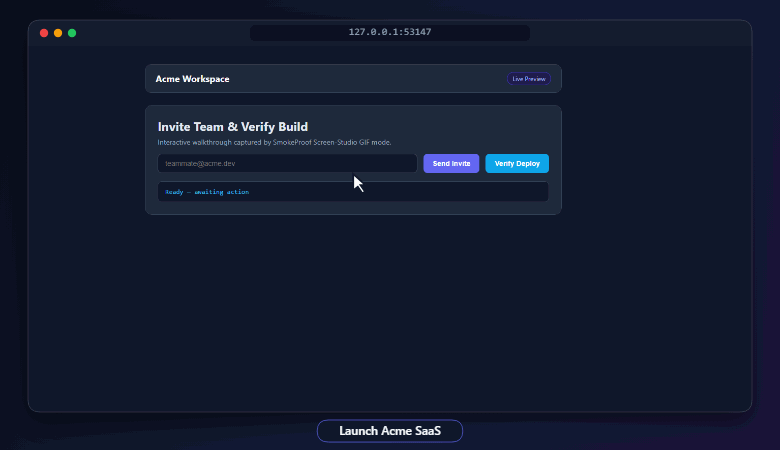

# SmokeProof

**Break your app before users do — Chaos Browser Testing, Screen-Studio Demo & Bug-Repro GIFs, and Click-to-Prompt Visual Review for AI Coding Agents.**

Zero cloud. Zero API keys. Zero FFmpeg setup. Runs locally on your existing **Chrome**, **Edge**, or **Chromium**.

[](./LICENSE)
[](https://nodejs.org/)
[](#mcp-server-8-tools)
[](#install-as-an-agent-skill)



*Walkthrough GIF above recorded locally by `smokeproof demo` (`gifenc` + Chromium Canvas, zero FFmpeg).*

---

## 3 Things SmokeProof Does Better Than Anyone Else

### 1. Chaos Bug-Breaker + Animated Repro GIFs (`smokeproof chaos`)
Skip boring static checklists. SmokeProof actively **attacks your running app** in headless Chromium:
- **Form & Input Fuzzing:** Submits empty inputs, 1800-char emoji strings, and harmless XSS canaries (``).
- **Double-Click Race & Offline Crash Checks:** Double-clicks primary actions and drops network connectivity to catch unhandled crashes.
- **Runtime, Mobile Overflow & Secret Leaks:** Intercepts `console.error`, uncaught exceptions, HTTP `4xx`/`5xx`, broken images, mobile `390px` horizontal overflow, and leaked API keys (`sk-`, `ghp_`, `AKIA`, DB URIs — auto-redacted).
- **Animated Bug-Repro GIF:** Whenever chaos mode catches a crash, it automatically renders a zoomed `.smokeproof/repro/chaos-*.gif` showing the exact action -> failure.

### 2. Screen-Studio Demo & README GIFs in 1 Command (`smokeproof demo`)
Point SmokeProof at any running app and generate a **Shareable Product Walkthrough GIF**:
- Wraps your app in a sleek **dark macOS window bezel** with URL pill.
- Smoothly moves an animated cursor, applies **cubic-eased camera zoom** + **click ripples**, and adds **floating step caption pills**.
- Pure JS + Chromium Canvas (`gifenc`) — **no FFmpeg, no cloud upload**.

### 3. Click-to-Prompt Visual Review Studio (`smokeproof studio`)
Review AI-built UI right against your live running app:
- Opens a local split-pane Studio (`http://127.0.0.1:4180`) proxying your live app cleanly (supports Vite/Next HMR).
- Toggle **Pin Element** -> click any button/card -> type *"Fix mobile padding"* -> saves exact **CSS selector + viewport + recent console/network errors** into `.smokeproof/annotations.json`.
- Copy a 1-click **Agent Fix Prompt**, or let Claude Code / Cursor / Antigravity pull pins directly via MCP (`smokeproof_get_annotations`).


---

## Where & Why to Use SmokeProof

- **Before shipping AI-built / vibe-coded apps:** Catch dead buttons, `[object Object]` UI leaks, broken images, console crashes, and mobile overflow that `tsc` never catches.
- **Inside your coding agent loop:** Let Claude Code, Cursor, Antigravity, or Codex run `smokeproof_chaos_test` / `smokeproof_audit`, inspect screenshots & pins, fix bugs, and re-verify via `smokeproof_verify_fix`.
- **For GitHub README & launch posts:** Generate clean zoomed walkthrough GIFs in seconds with `smokeproof demo`.
- **In CI & pre-commit checks:** Run `--cmd "npm run preview" --fail-on high --sarif` on PRs, or `--scan-only` to catch committed `.env` / client-exposed keys without launching a browser.

---

## Quickstart

### Option A: Run from Source (Recommended from GitHub)

```bash
git clone https://github.com/md1qamar/smokeproof.git
cd smokeproof
npm install
npm run build

# 1. Chaos-test another local app & wrap its dev server automatically
node dist/cli.js chaos --cmd "npm run dev" --cwd ../my-app http://localhost:3000 --scan-source

# 2. Record a Screen-Studio walkthrough GIF for your README / launch post
node dist/cli.js demo --cmd "npm run dev" --cwd ../my-app http://localhost:3000

# 3. Open Click-to-Prompt Visual Review Studio on a running app
node dist/cli.js studio http://localhost:3000

# 4. Standard high-signal audit (or target one specific page with --single)
node dist/cli.js http://localhost:3000
node dist/cli.js http://localhost:3000/checkout --single
node dist/cli.js http://localhost:3000 --routes /pricing,/checkout,/dashboard
```

> **Tip:** Run `npm link` once inside the cloned `smokeproof/` folder so `smokeproof ...` works globally from any repository.

### Option B: Run via `npx` (Once published to npm)

```bash
npx smokeproof chaos --cmd "npm run dev" http://localhost:3000 --scan-source
npx smokeproof demo --cmd "npm run dev" http://localhost:3000
npx smokeproof studio http://localhost:3000
npx smokeproof http://localhost:3000
```

Outputs are saved automatically to `.smokeproof/`:
- `.smokeproof/smokeproof-demo.gif` — Screen-Studio launch/README GIF
- `.smokeproof/repro/*.gif` — Animated bug reproduction GIFs on chaos failures
- `.smokeproof/smokeproof-report.html` — Visual report with embedded screenshots & Repro GIFs
- `.smokeproof/smokeproof-report.json` — Machine-readable contract for agents
- `.smokeproof/annotations.json` — Visual review pins from Studio

---

## Sample Output

```text
SmokeProof v0.1.0   FAIL   Score: 0/100
Target: http://127.0.0.1:63822/  | Browser: Google Chrome  | Duration: 3.17s
Routes: 1  | Findings: 10 (2 critical, 5 high, 2 medium, 1 low)

/ [HTTP 200, 2333ms] - 10 issue(s)
  [HIGH] [desktop] Broken image failed to load: /assets/revenue-chart.png (asset/broken-image)
         Selector: img
         Fix: Verify the image URL/path exists in public assets and returns HTTP 200.
  [HIGH] Serialized "[object Object]" rendered in UI: "Account tier: [object Object]" (content/object-object-leak)
         Selector: div.muted
         Fix: Replace placeholder text or handle missing/object state before rendering.
  [MED ] Control "Export CSV" produced no observable UI, URL, attribute, or network change when clicked. (interaction/dead-control)
         Selector: #export-btn
         Fix: Wire up the onClick handler or mark disabled/informative if non-interactive.
  [HIGH] [mobile] Horizontal overflow detected on mobile (788px content > 390px viewport). (layout/horizontal-overflow)
         Selector: div.wide-table
         Evidence: Offending elements: div.wide-table (+398px), strong (+113px), p.muted (+377px)
         Fix: Apply max-w-full / overflow-x-hidden or fix fixed-width containers/tables exceeding viewport width.
  [HIGH] Console error: Failed to hydrate billing telemetry widget (runtime/console-error)
         Evidence: Failed to hydrate billing telemetry widget
         Fix: Fix the root cause of the console.error before shipping.
  [CRIT] Server returned HTTP 500 for GET /api/billing (network/http-5xx)
         Evidence: 500 GET http://127.0.0.1:63822/api/billing
         Fix: Fix the server error or unhandled exception on this API/route endpoint.
  [CRIT] Exposed OpenAI / Provider Secret Key detected in live document response (/) (security/exposed-openai-key)
         Evidence: Matched redacted value: sk-pro...7654
         Fix: Move private credentials to server-side environment variables and rotate the exposed key immediately.
```

---

## Install as an Agent Skill

Compatible with **Claude Code**, **Cursor**, **Antigravity**, **Codex**, and **Gemini CLI** via [skills/smokeproof/SKILL.md](./skills/smokeproof/SKILL.md):

```bash
npx skills add md1qamar/smokeproof
```

---

## MCP Server (8 Tools)

### Local Clone Config (Works immediately)

Add SmokeProof to your MCP client (`claude_desktop_config.json`, `.cursor/mcp.json`, Antigravity MCP config, etc.) pointing to your built `dist/cli.js`:

```json
{
  "mcpServers": {
    "smokeproof": {
      "command": "node",
      "args": ["/absolute/path/to/smokeproof/dist/cli.js", "--mcp"]
    }
  }
}
```

### `npx` Config (Once published to npm)

```json
{
  "mcpServers": {
    "smokeproof": {
      "command": "npx",
      "args": ["-y", "smokeproof", "--mcp"]
    }
  }
}
```

| Tool | Purpose |
| --- | --- |
| `smokeproof_chaos_test` | Fuzz forms, XSS, double-clicks & offline resilience + generate Repro GIFs |
| `smokeproof_record_demo` | Record an auto-explored or scripted Screen-Studio demo GIF |
| `smokeproof_get_annotations` | Fetch open visual pins & formatted prompt from SmokeProof Studio |
| `smokeproof_resolve_annotation` | Mark a visual pin resolved after fixing it |
| `smokeproof_audit` | Full same-origin crawl across desktop & mobile with annotated screenshots |
| `smokeproof_check_route` | Fast single-route inspection after targeted edits |
| `smokeproof_verify_fix` | Re-audit and return `{ resolved, remaining, introduced, passed, score }` |
| `smokeproof_scan_source` | Instant static scan (no browser) for `.env` leaks, keys & unsafe HTML |

---

## CLI Reference

```text
smokeproof <url> [options]          Standard high-signal browser audit
smokeproof chaos <url> [options]    Chaos bug-breaker + animated Repro GIF
smokeproof demo <url> [options]     Screen-Studio demo GIF generator
smokeproof studio <url> [options]   Click-to-Prompt visual review UI

Flags:
  --cmd <command>          Start dev/preview server & tear down cleanly afterward
  --cwd <dir>              Target workspace directory (default: .)
  --chaos                  Enable chaos form fuzzing, double-click & offline probes
  --strict                 Include strict a11y/SEO & localhost advisory checks
  --max-pages <n>          Maximum same-origin routes to crawl (default: 12)
  --max-depth <n>          Maximum link crawl depth (default: 2)
  --single, --no-crawl     Audit only the exact URL provided without crawling links
  --routes <r1,r2,...>     Audit only specific comma-separated routes (e.g. /pricing,/checkout)
  --timeout <ms>           Navigation/server startup timeout in ms (default: 15000)
  --no-mobile              Skip 390x844 mobile viewport layout audit
  --no-interact            Skip safe interactive button/tab probing
  --no-screenshots         Skip saving annotated PNG screenshots
  --scan-source            Include static workspace secret/.env scan
  --scan-only              Run static workspace scan only (no browser)
  --json | --markdown | --sarif | --html
  --out <path>             Custom output path (report or .gif)
  --artifacts-dir <dir>    Directory for screenshots, GIFs & reports (default: .smokeproof)
  --browser-path <path>    Explicit Chrome/Edge/Chromium executable path
  --port <port>            Studio UI port (default: 4180)
  --no-open                Do not auto-open browser in studio mode
  --fail-on <level>        critical | high | medium | low | none (default: high)
  --min-score <0-100>      Minimum passing ship score (default: 70)
  --mcp                    Start stdio MCP server
  --init                   Scaffold .smokeproof.json and GitHub Actions workflow
```

---

## Development & Tests

```bash
npm install
npm run typecheck
npm test
```

## License

MIT
