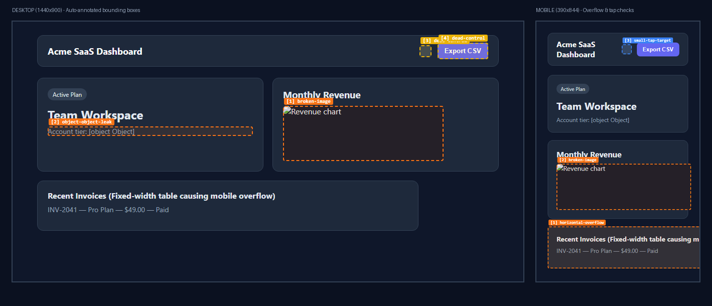

# SmokeProof

**Real-browser pre-ship verification for AI coding agents and humans.**  
Don't trust *"tsc passed"* — crawl your running app in headless Chromium across Desktop (`1440x900`) and Mobile (`390x844`), catch silent runtime errors, HTTP `4xx`/`5xx` failures, mobile overflow, dead buttons, broken images, and leaked secrets, and get annotated screenshots + machine-readable JSON fixes.

[](./LICENSE)
[](https://nodejs.org/)
[](#mcp-server-claude-code-cursor-antigravity--codex)
[](#install-as-an-agent-skill)



---

## Where & Why to Use SmokeProof

AI coding agents are great at making code compile — and notorious for shipping broken runtime behavior. Use SmokeProof whenever you want real-browser proof before calling a task "done":

- **Before launching AI-built / vibe-coded apps:** Catch dead buttons, `[object Object]` UI leaks, missing images, console crashes, and broken `390px` mobile layouts that `tsc` and unit tests completely miss.
- **Inside your coding agent loop (Claude Code, Cursor, Antigravity, Codex):** Let your agent call SmokeProof via Skill/MCP, inspect the annotated screenshots and JSON findings, fix the root causes, and re-run verification (`smokeproof_verify_fix`) automatically.
- **On every Pull Request (CI gate):** Boot your app with `--cmd`, fail builds on `critical`/`high` regressions, and export Markdown PR summaries or GitHub Code Scanning `--sarif`.
- **Instant pre-commit secret check (`--scan-only`):** Scan your codebase for committed `.env` files, client-exposed `NEXT_PUBLIC_*` / `VITE_*` secrets, `dangerouslySetInnerHTML`, and hardcoded `localhost` URLs without launching a browser.

| What slips past `tsc` & unit tests | What SmokeProof catches in a real browser |
| --- | --- |
| Silent `console.error` & uncaught exceptions | Captures `pageerror`, `console.error`, and framework hydration warnings |
| Broken API endpoints (`4xx` / `5xx`) | Intercepts failed XHR/fetch/asset requests with status & route evidence |
| Mobile layout explosions | Audits both `1440x900` desktop and `390x844` mobile for horizontal overflow & overlapping controls |
| Dead buttons with empty handlers | Safely probes non-destructive buttons/tabs (`--interact`) and detects throws or zero-effect clicks |
| Leaked API keys in client bundles | Scans live JS/SSR responses & `.env` files for `sk-`, `ghp_`, `AKIA`, DB URIs (auto-redacted) |
| `[object Object]`, `NaN`, `Lorem ipsum` | Detects broken template rendering and missing `<title>`, `<meta viewport>`, labels, and `alt` text |

**Zero forced 300 MB browser download:** SmokeProof automatically detects your existing **Google Chrome**, **Microsoft Edge**, **Brave**, or **Playwright Chromium** installation.

---

## Quickstart

### Option A: Run from Source (Recommended from GitHub)

```bash
git clone https://github.com/md1qamar/smokeproof.git
cd smokeproof
npm install
npm run build

# 1. Audit any already-running app
node dist/cli.js http://localhost:3000

# 2. Or auto-start another project's dev server, audit it, and shut it down cleanly
node dist/cli.js --cmd "npm run dev" --cwd ../my-app http://localhost:3000 --scan-source

# 3. Static secret & source hygiene scan only (no browser needed)
node dist/cli.js --scan-only --cwd ../my-app
```

> **Tip:** Run `npm link` once inside the cloned `smokeproof/` folder so you can run `smokeproof http://localhost:3000` directly from any project directory.

### Option B: Run via `npx` (Once published to npm)

```bash
npx smokeproof http://localhost:3000
npx smokeproof --cmd "npm run dev" http://localhost:3000 --scan-source
```

### Machine-Readable Formats & Saved Artifacts

```bash
smokeproof http://localhost:3000 --json
smokeproof http://localhost:3000 --markdown
smokeproof http://localhost:3000 --sarif --out smokeproof.sarif
```

Every run writes artifacts to `.smokeproof/`:
- `.smokeproof/smokeproof-report.json` — machine-readable findings, selectors, and fix suggestions
- `.smokeproof/smokeproof-report.html` — self-contained visual report with embedded screenshots
- `.smokeproof/screenshots/*.png` — annotated PNGs highlighting exact failing bounding boxes

---

## Sample Output

### Terminal Report

```text
SmokeProof v0.1.0   FAIL   Score: 0/100
Target: http://127.0.0.1:63822/  | Browser: Google Chrome  | Duration: 3.17s
Routes: 1  | Findings: 10 (2 critical, 5 high, 2 medium, 1 low)

/ [HTTP 200, 2333ms] - 10 issue(s)
  [HIGH] [desktop] Broken image failed to load: /assets/revenue-chart.png (asset/broken-image)
         Selector: img
         Fix: Verify the image URL/path exists in public assets and returns HTTP 200.
  [HIGH] Serialized "[object Object]" rendered in UI: "Account tier: [object Object]" (content/object-object-leak)
         Selector: div.muted
         Fix: Replace placeholder text or handle missing/object state before rendering.
  [MED ] Control "Export CSV" produced no observable UI, URL, attribute, or network change when clicked. (interaction/dead-control)
         Selector: #export-btn
         Fix: Wire up the onClick handler or mark disabled/informative if non-interactive.
  [HIGH] [mobile] Horizontal overflow detected on mobile (788px content > 390px viewport). (layout/horizontal-overflow)
         Selector: div.wide-table
         Evidence: Offending elements: div.wide-table (+398px), strong (+113px), p.muted (+377px)
         Fix: Apply max-w-full / overflow-x-hidden or fix fixed-width containers/tables exceeding viewport width.
  [HIGH] Console error: Failed to hydrate billing telemetry widget (runtime/console-error)
         Evidence: Failed to hydrate billing telemetry widget
         Fix: Fix the root cause of the console.error before shipping.
  [CRIT] Server returned HTTP 500 for GET /api/billing (network/http-5xx)
         Evidence: 500 GET http://127.0.0.1:63822/api/billing
         Fix: Fix the server error or unhandled exception on this API/route endpoint.
  [CRIT] Exposed OpenAI / Provider Secret Key detected in live document response (/) (security/exposed-openai-key)
         Evidence: Matched redacted value: sk-pro...7654
         Fix: Move private credentials to server-side environment variables and rotate the exposed key immediately.
```

### JSON Output (`--json`)

```json
{
  "summary": {
    "score": 0,
    "passed": false,
    "routesAudited": 1,
    "totalFindings": 10,
    "bySeverity": { "critical": 2, "high": 5, "medium": 2, "low": 1 }
  },
  "sampleFindings": [
    {
      "severity": "high",
      "rule": "asset/broken-image",
      "viewport": "desktop",
      "message": "Broken image failed to load: /assets/revenue-chart.png",
      "selector": "img",
      "suggestion": "Verify the image URL/path exists in public assets and returns HTTP 200."
    }
  ]
}
```

---

## Install as an Agent Skill

Compatible with **Claude Code**, **Cursor**, **Antigravity**, **Codex**, and **Gemini CLI** via the [Agent Skills open standard](./skills/smokeproof/SKILL.md):

```bash
npx skills add md1qamar/smokeproof
```

Once installed, your agent automatically runs static secret checks, crawls the live app across desktop and mobile, inspects annotated screenshots, fixes root causes, and re-verifies before marking the task complete.

---

## MCP Server (Claude Code, Cursor, Antigravity, Codex)

### Local Clone Config (Works immediately)

Point your MCP client config (`claude_desktop_config.json`, `.cursor/mcp.json`, Antigravity MCP config, etc.) to your built `dist/cli.js`:

```json
{
  "mcpServers": {
    "smokeproof": {
      "command": "node",
      "args": ["/absolute/path/to/smokeproof/dist/cli.js", "--mcp"]
    }
  }
}
```

### `npx` Config (Once published to npm)

```json
{
  "mcpServers": {
    "smokeproof": {
      "command": "npx",
      "args": ["-y", "smokeproof", "--mcp"]
    }
  }
}
```

### Exposed MCP Tools

| Tool | Purpose |
| --- | --- |
| `smokeproof_audit` | Full same-origin crawl across desktop & mobile with screenshots, interaction probing, and optional `--cmd` server wrapper |
| `smokeproof_check_route` | Fast single-route deep inspection after editing a specific page |
| `smokeproof_verify_fix` | Re-runs the audit and returns `{ resolved, remaining, introduced, passed, score }` |
| `smokeproof_scan_source` | Instant static scan (no browser) for `.env` leaks, client-prefixed secrets, `dangerouslySetInnerHTML`, and hardcoded localhost URLs |

---

## CLI Reference

```text
smokeproof <url> [options]

Options:
  --cmd <command>          Start dev/preview server and shut down cleanly after audit
  --cwd <dir>              Target workspace directory (default: .)
  --max-pages <n>          Maximum same-origin routes to crawl (default: 12)
  --max-depth <n>          Maximum link crawl depth (default: 2)
  --timeout <ms>           Navigation/server startup timeout in ms (default: 15000)
  --no-mobile              Skip 390x844 mobile viewport layout audit
  --no-interact            Skip safe interactive button/tab probing
  --no-screenshots         Skip saving annotated PNG screenshots
  --scan-source            Include static workspace secret/.env scan
  --scan-only              Run static workspace scan only (no browser launch)
  --fail-on <level>        critical | high | medium | low | none (default: high)
  --min-score <0-100>      Minimum passing ship score (default: 70)
  --json                   Output machine-readable JSON
  --markdown               Output Markdown report
  --sarif                  Output SARIF v2.1.0 JSON
  --html                   Output self-contained HTML report
  --out <path>             Write formatted output to a file
  --artifacts-dir <dir>    Directory for screenshots & reports (default: .smokeproof)
  --browser-path <path>    Explicit Chrome/Edge/Chromium executable path
  --include <pattern>      Only crawl matching routes (repeatable)
  --exclude <pattern>      Skip matching routes (repeatable)
  --ignore-rule <ruleId>   Suppress a specific rule ID (repeatable)
  --mcp                    Start stdio MCP server
  --init                   Scaffold .smokeproof.json and GitHub Actions workflow
```

---

## Programmatic API

```ts
import { runSmokeAudit, verifySmokeFixes, scanWorkspaceSource } from 'smokeproof';

const report = await runSmokeAudit('http://localhost:3000', {
  maxPages: 10,
  mobile: true,
  interact: true,
  scanSource: true,
});

console.log(`Score: ${report.summary.score}/100 (${report.summary.passed ? 'PASS' : 'FAIL'})`);
```

---

## Project Config (`.smokeproof.json`) & GitHub Actions

Bootstrap configuration + CI workflow in one command:

```bash
smokeproof --init
```

---

## Development & Tests

```bash
npm install
npm run typecheck
npm test
```

## License

MIT
